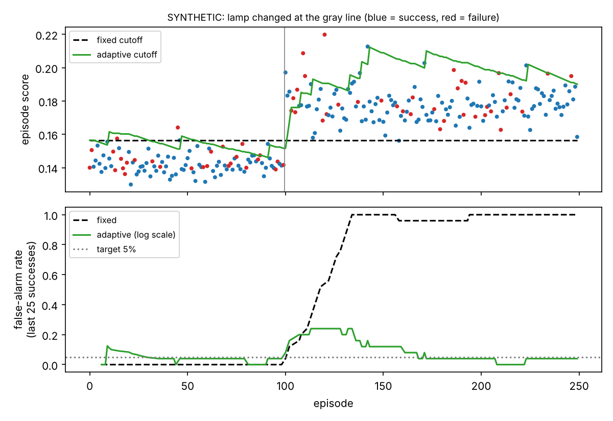

# ShiftBench

**Do robot failure alarms keep their promise when the camera moves?**

A world model watches a $240 SO-101 arm and raises an alarm when what happens
stops matching what it predicted. Published detectors calibrate that alarm to
a promised false-alarm rate, then test it in the same setup. ShiftBench
measures what happens to the promise when the lamp moves, the camera gets
bumped, the table changes or a new object shows up, and provides an adaptive
cutoff that keeps a stated guarantee under any of those.

> **Status (Nov 2026): code complete and tested; no robot data yet.** Every
> number in `results/synthetic/` comes from a toy latent world that checks
> the code. They are not robot results and must not be reported as such.

## How it works

```
camera frame ──► V-JEPA 2 (frozen, Meta, MIT) ──► latent z_t ─┐
joint state + commanded action ───────────────────────────────┼─► small predictor ──► ẑ_{t+1}
                                                               │
                         surprise e_t = |ẑ_t − z_t|, smoothed ─┴─► alarm if s_t > cutoff
```

* **Predictor** (`predictor.py`): a residual MLP trained only on successful nominal rollouts, L1 loss as in V-JEPA 2-AC.
* **Fixed cutoff** (`calibrate.py`): split conformal on held-out successes. If a new successful run is exchangeable with them, P(false alarm) ≤ α. This is the published-style promise.
* **Adaptive cutoff** (`adaptive.py`): after every successful run, τ ← τ + η(alarm − α). On *any* sequence of runs, false alarms / T ≤ α + (s_max + η − τ₁)/(ηT). Proved in the docstring, tested on adversarial sequences in `tests/`.
* **Live watchdog** (`plugins/lerobot_robot_shiftbench`): a LeRobot plugin. `--robot.type=so101_watchdog` works with the stock `lerobot-rollout`, scores frames on a background thread, and holds the arm in place when the alarm trips (`mode=stop`) or only logs (`mode=shadow`).

## Pre-registered hypotheses

**Pre-registered November 6, 2026, before any robot data was recorded.** The commit history is the timestamp. Analysis plan: `docs/PROTOCOL.md` and `shiftbench/benchmark.py` as of that commit.

* **H1** After a controlled shift, the fixed cutoff's false-alarm rate on successful runs exceeds α.
* **H2** The adaptive cutoff stays within its bound under every shift and lands closer to α than the fixed cutoff.
* **H3** (exploratory) A self-referenced score cancels part of camera and lighting shifts without losing detection.

## Quickstart

```bash
pip install -e ".[vjepa,lerobot,dev]"          # Python 3.10–3.12
pip install "lerobot[dataset,serial-motors]"   # serial-motors is needed to drive the arm
pip install -e plugins/lerobot_robot_shiftbench
pytest -q                                      # 26 tests, no GPU or downloads
python scripts/synthetic_experiment.py         # toy-world sanity run
```

Before the arm arrives: open `notebooks/shiftbench_colab.ipynb` on a Colab T4
and run the **ArmnetBench pilot**. It trains on human teleop demos of
`block_stack` and tests the promise on rollouts from seven different policies.

With the arm:

```bash
bash scripts/record_session.sh nominal 0 50       # policy rollouts, shadow mode, then label s/f
bash scripts/record_session.sh light_dim 1 40     # one condition per session
# on Colab:
bash scripts/encode_sessions.sh cache/front observation.images.front
python scripts/train_detector.py --cache cache/front --out runs/detector --alpha 0.05
python scripts/run_benchmark.py --cache cache/front --detector runs/detector --out results/real --k 20
```

The demo where the arm stops itself:

```bash
lerobot-rollout --strategy.type=base --duration=20 \
  --robot.type=so101_watchdog --robot.port=$FOLLOWER_PORT --robot.id=$ARM_ID \
  --robot.cameras='{front: {type: opencv, index_or_path: 0, width: 640, height: 480, fps: 30}}' \
  --robot.detector_dir=runs/detector --robot.watch_camera=front --robot.mode=stop \
  --policy.path=$POLICY --task="Put the red cube in the bowl"
```

## What the toy world says to expect (synthetic, not results)



At α = 5%, after a large lamp change the fixed cutoff false-alarmed on 100% of
successful runs, and the log-scale adaptive cutoff on 6%. Recalibrating on 30
reruns also works, but needs ≥ 19 successes among them: in the toy "new
object" condition, too few succeeded in 88% of orderings, and it never alarmed.
The cost of adapting is real too: once the cutoff rises to stop the false
alarms, it misses more failures. The plot shows that, and the paper must
report it.

## Layout

```
shiftbench/        encoders, predictor, scores, calibrate, adaptive, detector, benchmark, data, labeling, rolloutcheck
plugins/           LeRobot plugin: so101_watchdog
scripts/           record_session.sh, encode_dataset.py, encode_sessions.sh, train_detector.py, run_benchmark.py, synthetic_experiment.py
configs/shifts.yaml  every shift condition, reproducibly specified
docs/              HARDWARE.md (shopping list), PROTOCOL.md (data plan + 2-week plan), RELATED_WORK.md
notebooks/         Colab: sanity check, V-JEPA speed test, ArmnetBench pilot, your sessions
tests/             conformal + adaptive guarantees, offline/online scorer equivalence, plugin wiring with a fake bus
```

`rolloutcheck` (early): `rolloutcheck --repo_id someone/dataset --detector runs/detector --out reports/x` flags surprising episodes in any LeRobot dataset and writes an HTML report.

## Related work

FAIL-Detect (RSS 2025), Foresight (2026, V-JEPA 2-AC latents + functional
conformal), FoMo-FD (2026) and others already detect failures with world
models and conformal thresholds, all calibrated in the test setup. ArmnetBench
gives SO-101 success/failure labels but no shift labels. Details and the
honest novelty statement are in `docs/RELATED_WORK.md`.

## License

MIT (code). Datasets you publish: CC-BY-4.0 or Apache-2.0.
